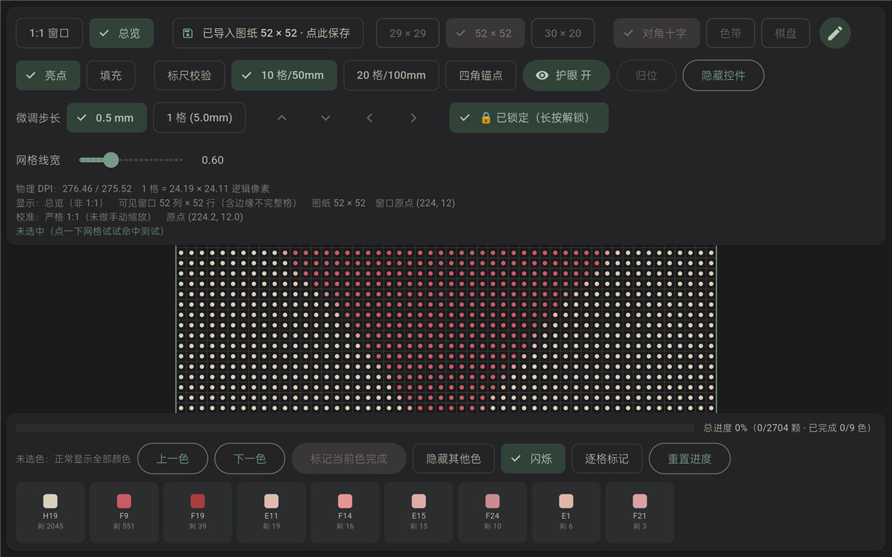
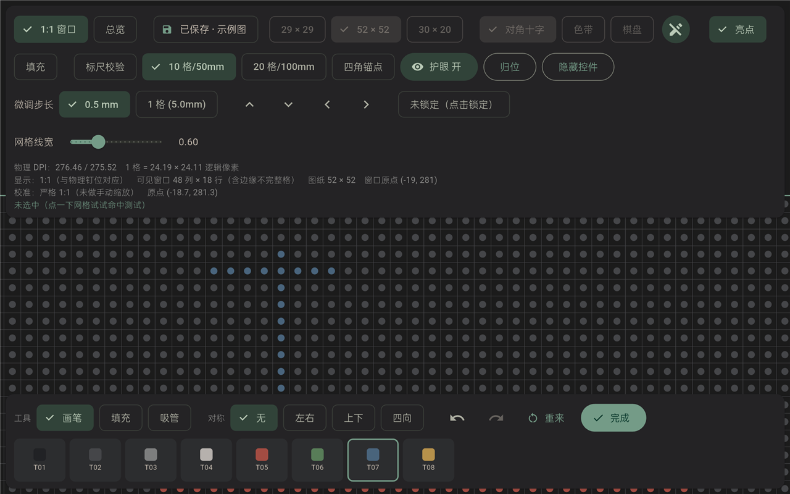
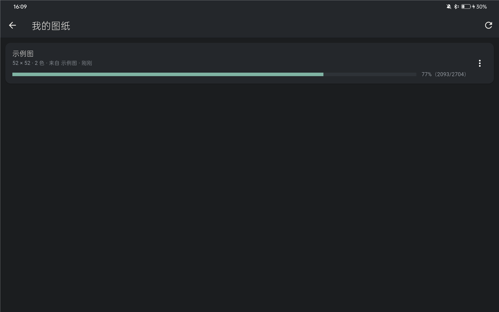

# 豆

**透明板拼豆辅助** —— 把透明拼豆板放在平板上，屏幕就是灯板。

用平板屏幕按**真实物理尺寸**显示网格与色号，跟着屏幕逐色放豆子即可。
不需要蓝牙、不需要智能灯板、不联网、不上传任何图片。



---

## 为什么是"屏幕当灯板"

常见的拼豆灯板要么小、要么贵、要么要连手机。而平板屏幕本身就有两个刚需特性：

1. **尺寸够大**：52×52 的板子对应 260mm 见方，10 寸以上平板可以分区域逐块拼。
2. **每个豆孔都能被单独点亮**：软件可以只高亮"当前要放的那一色"。

所以这个 App 做的事很简单：**把图纸按 1:1 物理尺寸画在屏幕上，然后一块一块地引导你放豆子**。

## 功能

| 功能 | 说明 |
|---|---|
| **1:1 物理网格** | 读取设备真实 `xdpi/ydpi` 渲染。实测：实体尺子量 10 格 = **50.0mm**（5mm 标准豆） |
| **对齐校准** | 拖动平移 / 双指缩放微调、四角锚点、一键锁定防误触；参数持久化，重启保留 |
| **图片导入** | 相册选图或内置示例 → 自绘裁剪 → 面积平均降采样 → **CIE Lab 感知量化**到色卡 |
| **逐色引导** | 单色高亮闪烁、分步逐色（标记完成自动跳下一色）、进度统计 |
| **图纸编辑** | 画笔 / 油漆桶 / 吸管、左右·上下·四向对称、撤销重做 |
| **项目保存** | 图纸与拼豆进度自动落盘，重启接着拼 |
| **护眼** | 软件调光 + 暖色调、低对比、沉浸式全屏、屏幕常亮 |

<p float="left">
  
  
</p>

## 已知限制

- **52×52 板大于常见平板屏幕**（260mm 见方 vs 屏幕 235×148mm），因此必须**分区域引导**：
  拼完一块抬起板子挪到下一区域。这是物理约束，不是实现偷懒。
- **没有"空格子"概念**：每一格都必须有颜色，暂时不能把某格标记为"不放豆"。
- 色卡默认是 **MARD 221**；Perler / Hama / Artkal 仍为空，可按
  [docs/palette-schema.md](docs/palette-schema.md) 自行填写。
- 色卡数据的 77 个 HEX 在两个来源间存在分歧，**请以实物色卡为准**（见
  [THIRD-PARTY-NOTICES.md](THIRD-PARTY-NOTICES.md)）。

## 快速开始

**直接用**：下载 Release 里的 APK 安装即可（Android 7.0 / API 24 以上，横屏）。

**从源码构建**：

```bash
# 需要 Flutter 3.47+ 与 Android SDK（JDK 17）
flutter pub get
flutter test            # 391 个测试
flutter build apk --release
```

产物在 `build/app/outputs/flutter-apk/app-release.apk`。

> 若在国内网络下构建，建议设置镜像：
> `FLUTTER_STORAGE_BASE_URL=https://storage.flutter-io.cn`、
> `PUB_HOSTED_URL=https://pub.flutter-io.cn`；Gradle 的坑见
> [docs/dev-notes.md](docs/dev-notes.md)。

**Windows 桌面版**：代码里带了 `windows/` 目录，但需要开启 Windows 的"开发人员模式"
（Flutter 插件的软链接要求），否则构建会失败。本项目主要面向 Android 平板。

## 文档

- [docs/dev-notes.md](docs/dev-notes.md) —— 开发环境、踩过的坑、真机验证记录（含每个阶段怎么验的）
- [docs/palette-schema.md](docs/palette-schema.md) —— 色卡与板规格 JSON 格式说明
- [THIRD-PARTY-NOTICES.md](THIRD-PARTY-NOTICES.md) —— 第三方数据来源与许可证

## 数据来源

MARD 色卡数据来自 [HansBug/pindou-color-data](https://github.com/HansBug/pindou-color-data)
（MIT License, Copyright (c) 2026 HansBug），该仓库交叉验证了多个公开来源。
详情与已知分歧见 [THIRD-PARTY-NOTICES.md](THIRD-PARTY-NOTICES.md)。

## 许可证

[MIT](LICENSE) © 2026 Wwwooo157

「MARD」「Perler」「Hama」「Artkal」等为各自品牌商标，本项目与其无关联。
